# Tehtävä 1 - Getting started with node.js

**GitHub Repositorio (node-start):** https://github.com/HelmiPit/Viikkoteht-v-t---K-ytt-j-keskeinen-sovelluskehitys/tree/node-start

## Mitkä osiot sait tehtyä

Sain tehtyä kaikki osiot 1-6.

## Mahdolliset ongelmat

Ei tullut varsinaisia ongelmia, mutta lisäsin jonkin verran virheenkäsittelyä (esim. virheellisen JSON-datan käsittely `try-catch`-lohkossa sekä 404-virheet JSON-muodossa) ja muutin koodia siistimmäksi.

Lisäsin yhden oman ominaisuuden (Search items by name), jonka tarkoitus on suodattaa ja hakea itemit nimen perusteella käyttäen hakusanaa (GET /items?name=Item 1).

## Kuvakaappaukset sovelluksen toiminnasta

## 1. Get server root

HTTP request:

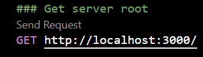

Response:

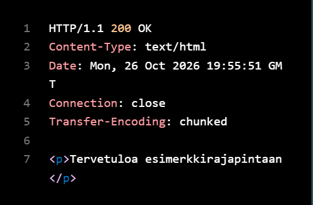

## 2. Get not found 404

HTTP request:

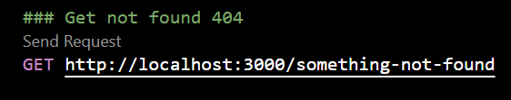

Response:

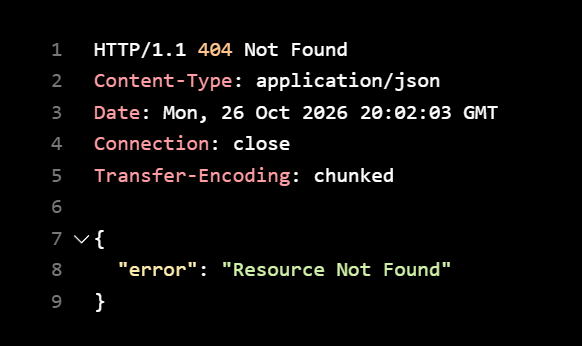

## 3. Get all items

HTTP request:

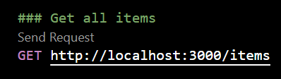

Response:

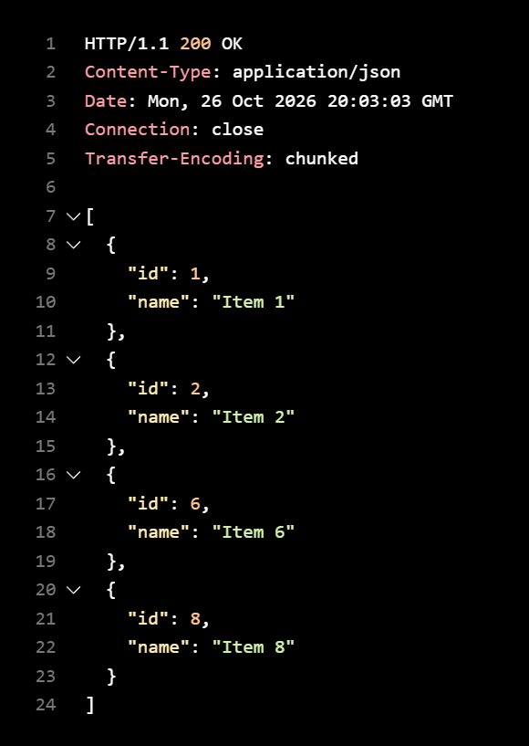

## 4. Get an item by id (existing)

HTTP request:

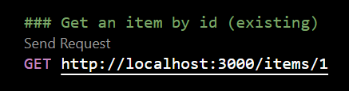

Response:

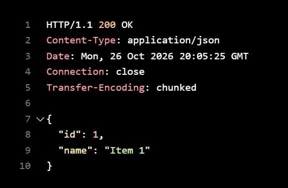

## 5. Get an item by id (not found - 404 test)

HTTP request:

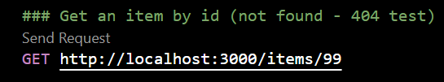

Response:

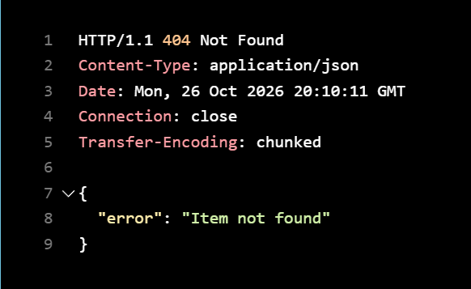

## 6. Search items by name (oma lisäys)

HTTP request:

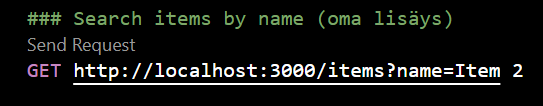

Response:

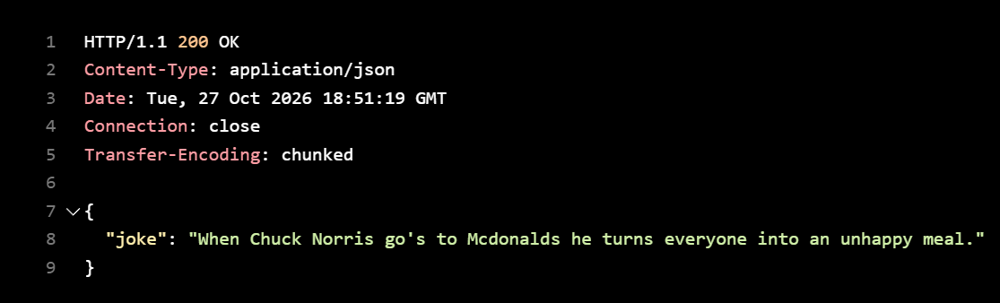

## 7. Post new item

HTTP request:

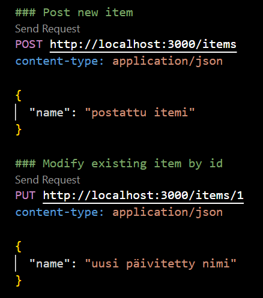

Response:

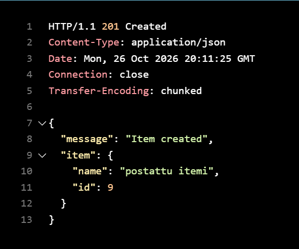

## 8. Modify existing item by id

HTTP request:

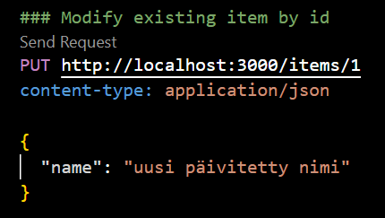

Response:

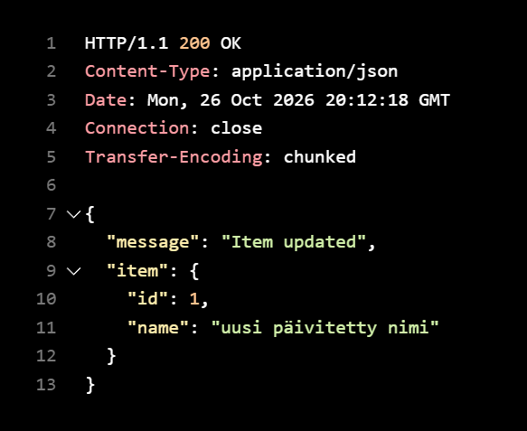

## 9. Modify item with invalid id (404 test)

HTTP request:

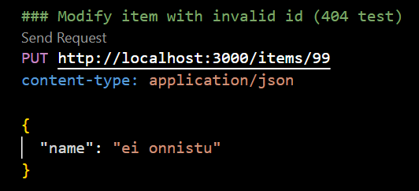

Response:

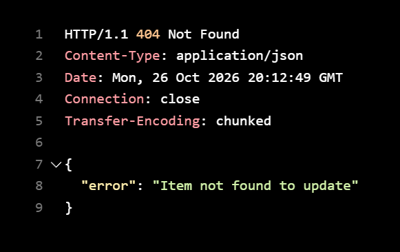

## 10. Delete item by id

HTTP request:

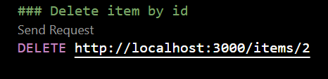

Response:

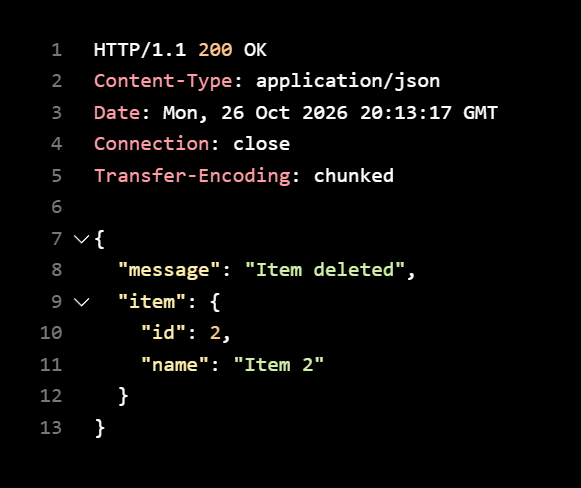

## 11. Delete item with invalid id (404 test)

HTTP request:

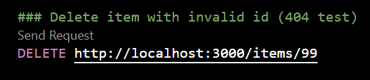

Response:

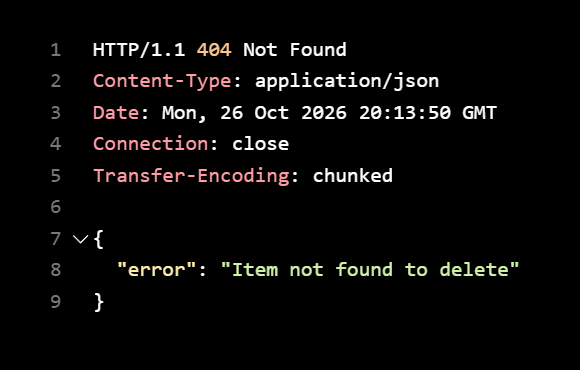
