# Tehtävä 5B - Input validation and error handling

Tämän sovelluksen tarkoitus on toimia medianjakopalvelun palvelimena. Sovellukseen lisätty virheenkäsittely ('notFoundHandler' ja 'errorHandler') sekä palvelinpuolen syötteiden validointi express-validator-kirjaston avulla MVC-mallin mukaisesti.

## Mitkä osiot sait tehtyä

Sain tehtyä kaikki osiot 1-3.

## Mahdolliset ongelmat

404-virheet palautuivat aluksi Expressin oletus HTML-sivuna ennen kuin 'notFoundHandler' ja 'errorHandler' lisättiin src/index.js-tiedoston loppuun.

## Kuvakaappaukset sovelluksen toiminnasta

## Error handling & 404 routes

### 1. Get not found 404

HTTP request:

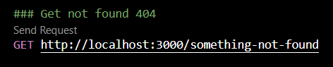

Response:

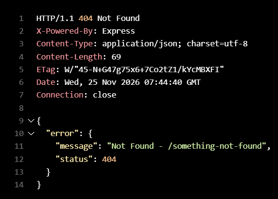

### 2. Get media item by id (Not found)

HTTP request:

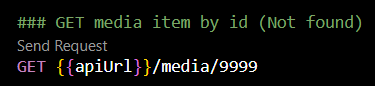

Response:

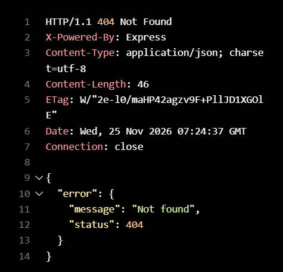

---

## Authentication routes

### 3. Post login

HTTP request:

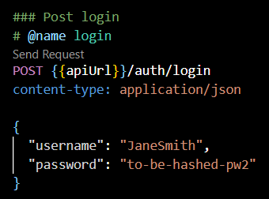

Response:

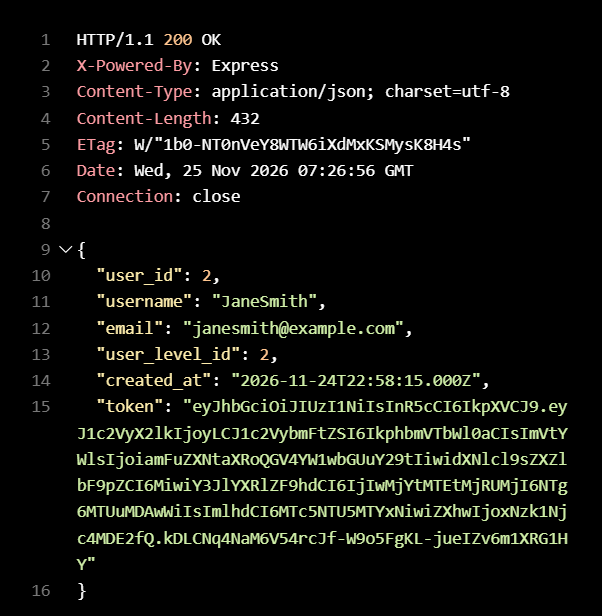

### 4. Post login (validation error: missing password)

HTTP request:

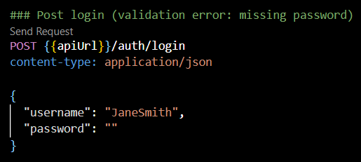

Response:

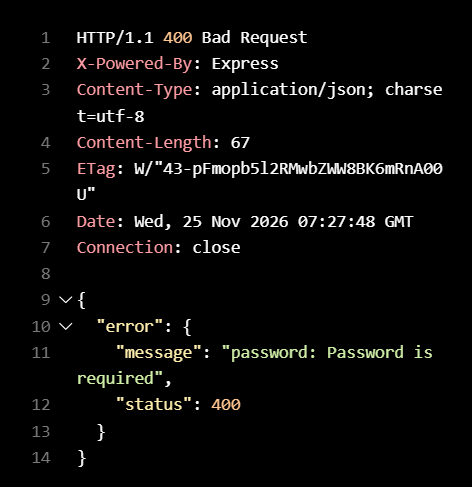

---

## /users requests

### 5. Register new user

HTTP request:

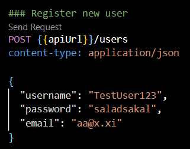

Response:

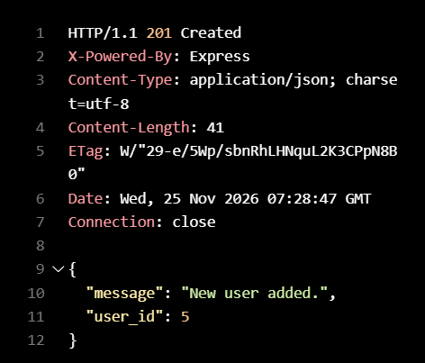

### 6. Register new user (validation error: invalid email & short password)

HTTP request:

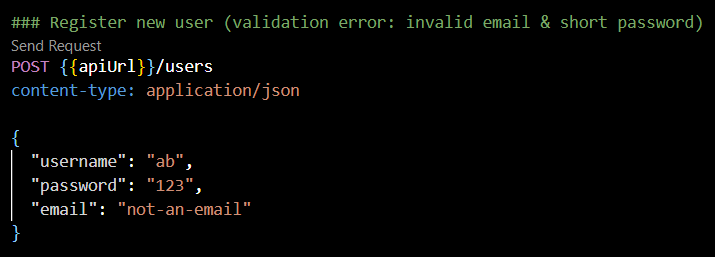

Response:

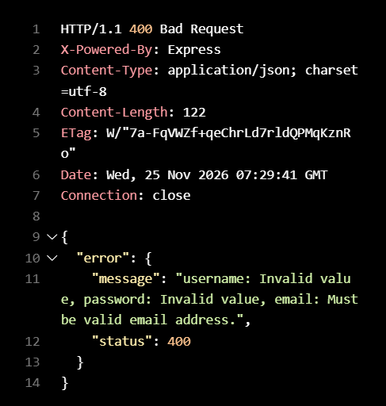

---

## /media requests

### 7. Get 3 latest media items (validation error)

HTTP request:

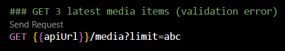

Response:

### 8. Get media item by id (validation error)

HTTP request:

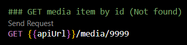

Response:

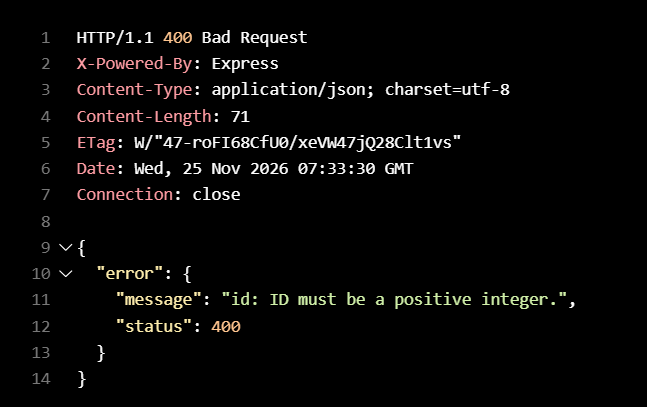

### 9. Add new media item with image (with token)

HTTP request:

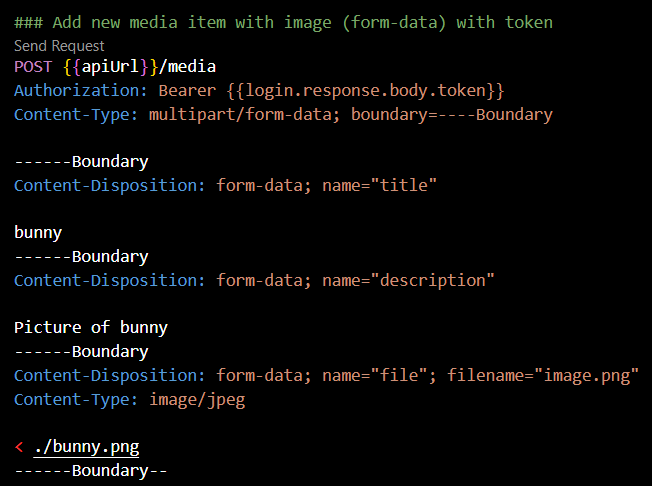

Response:

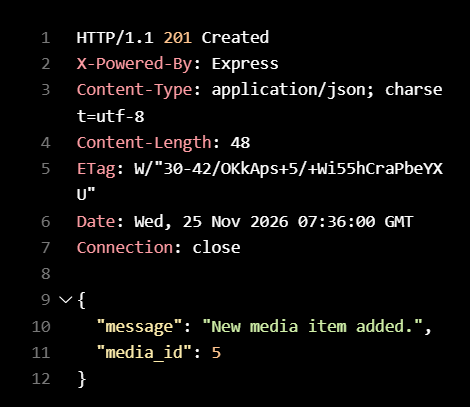

### 10. Add new media item (validation error: title too short)

HTTP request:

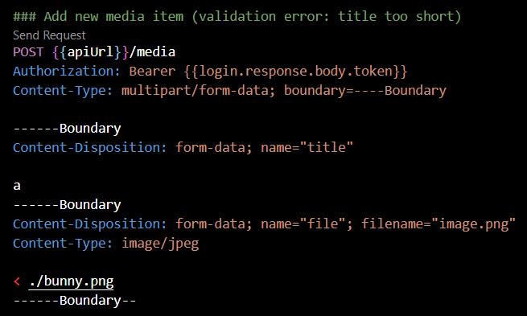

Response:

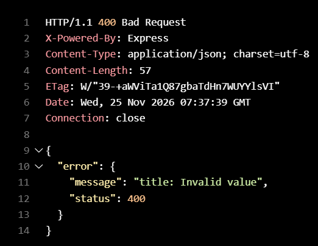
