# Tehtävä 5A - User authentication

Tämän sovelluksen tarkoitus on toimia medianjakopalvelun palvelimena. Tässä sovellukseen on lisätty käyttäjien tunnistautuminen (authentication) JWT-tokeneilla sekä käyttöoikeuksien hallinta (authorization) MVC-mallin mukaisesti.

## Mitkä osiot sait tehtyä

Sain tehtyä kaikki osiot 1-4.

## Mahdolliset ongelmat

Aluksi admin-käyttäjällä kirjautuminen palautti '401 Unauthorized', koska test-requests.http-tiedostossa oli väärä käyttäjätunnus suhteessa MediaSharingApp-tietokannan testidataan, ja 'jsonwebtoken'-kirjasto piti asentaa erikseen.

## Kuvakaappaukset sovelluksen toiminnasta

## Authentication routes

### 1. Post login (regular user)

HTTP request:

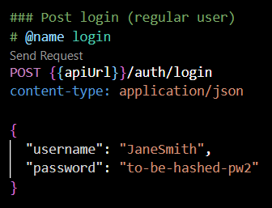

Response:

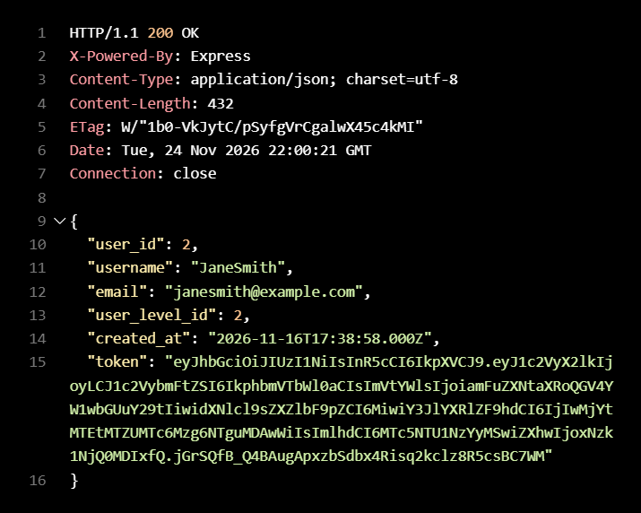

### 2. Post login (admin user)

HTTP request:

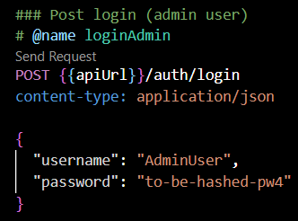

Response:

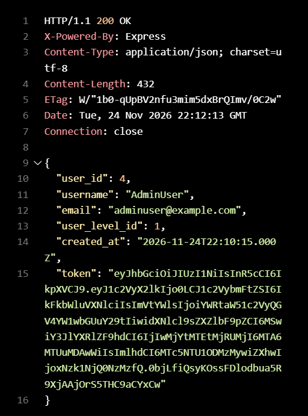

---

## /media requests

### 3. Add new media item (JSON, no file included)

HTTP request:

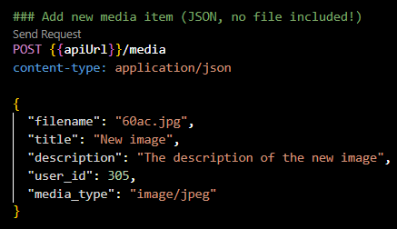

Response:

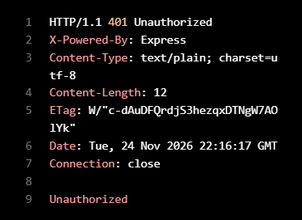

### 4. Modify own media item (user_id = 2)

HTTP request:

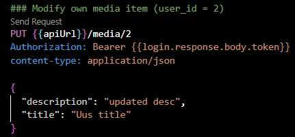

Response:

### 5. Modify another user's media item as regular user (unauthorized)

HTTP request:

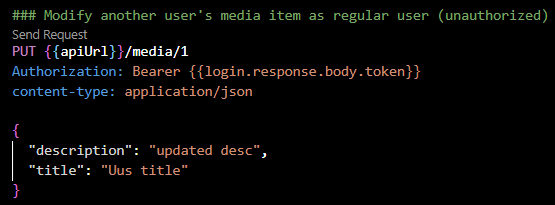

Response:

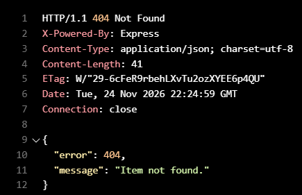

### 6. Delete own media item

HTTP request:

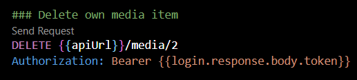

Response:

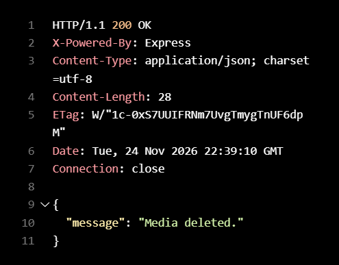

### 7. Delete any media item as admin

HTTP request:

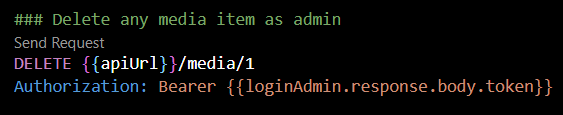

Response:

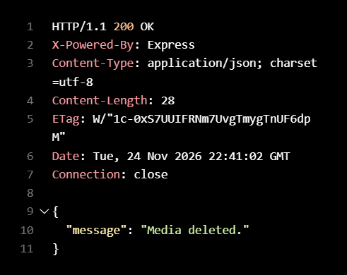

---

## /users requests

### 8. Modify own user info (user_id = 2)

HTTP request:

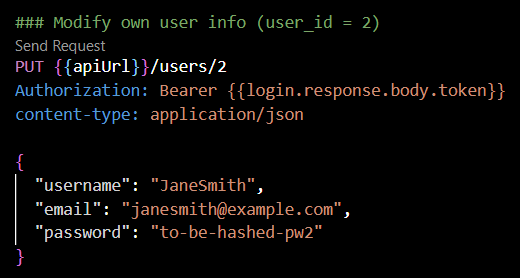

Response:

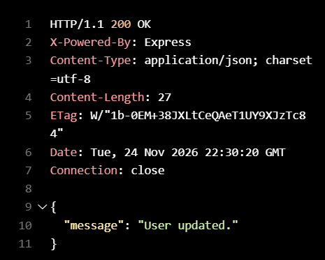

### 9. Modify another user info as regular user (forbidden)

HTTP request:

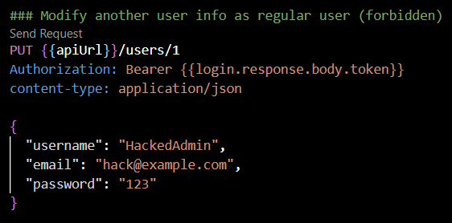

Response:

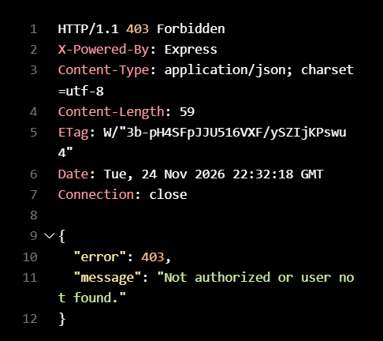

### 10. Modify any user info as admin

HTTP request:

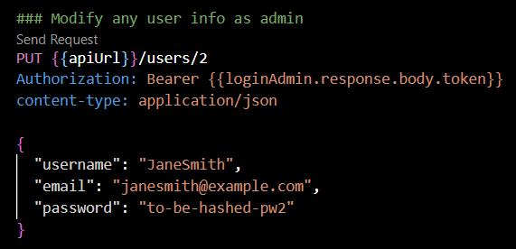

Response:

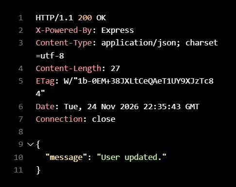
