# Tehtävä 4 - Express MVC and database

Tämän sovelluksen tarkoitus on toimia medianjakopalvelun palvelimena. Sen avulla käyttäjät voivat tallentaa tietokantaan kuvia ja videoita, selata niitä, muokata tai poistaa omia tietojaan sekä tykätä toisten käyttäjien julkaisuista.

## Mitkä osiot sait tehtyä

Sain tehtyä kaikki osiot 1-4.

## Mahdolliset ongelmat

Ei ollut varsinainen ongelma, mutta aluksi MariaDB-tietokannassa ei ollut mediatestuser-käyttäjää, koska se oli aiemmin luotu vain Microsoft Azuren pilvipalvelimelle. Ratkaisin tilanteen luomalla käyttäjän (CREATE USER), antamalla sille oikeudet MediaSharingApp-tietokantaan ja lisäämällä tunnukset .env-tiedostoon.

## Kuvakaappaukset sovelluksen toiminnasta

### 1. Get server root

HTTP request:

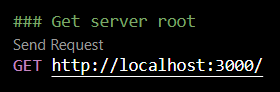

Response:

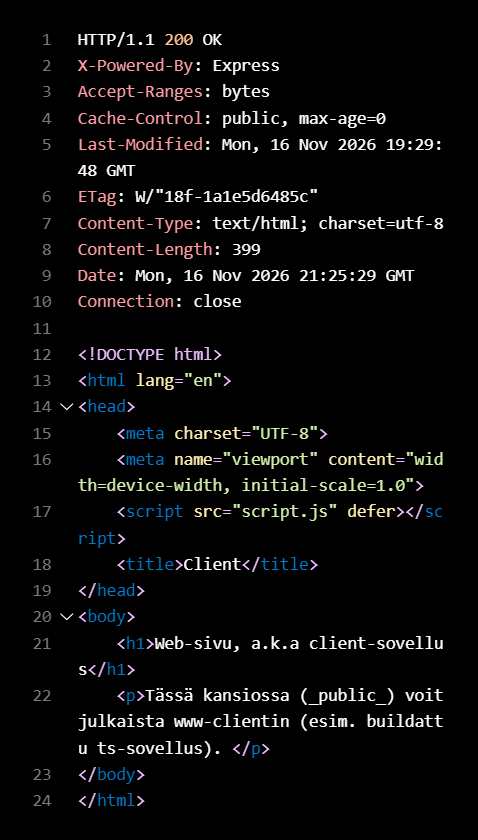

### 2. Get api root

HTTP request:

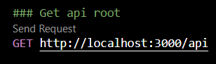

Response:

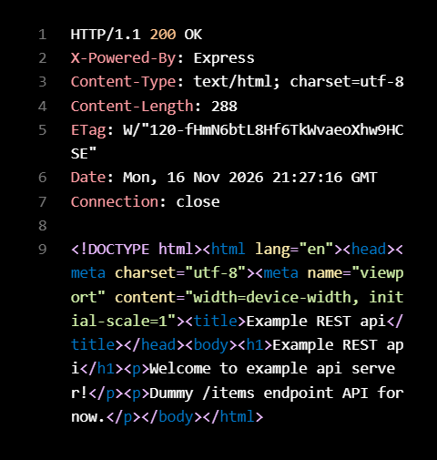

---

## /media requests

### 3. GET all media items

HTTP request:

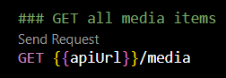

Response:

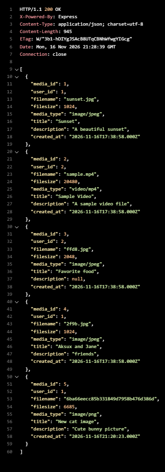

### 4. GET 2 media items

HTTP request:

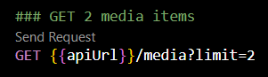

Response:

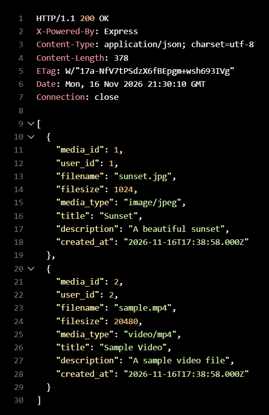

### 5. GET media item by id

HTTP request:

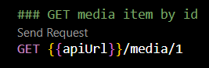

Response:

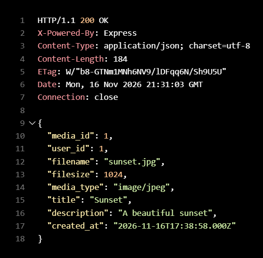

### 6. GET media item by id (Not found)

HTTP request:

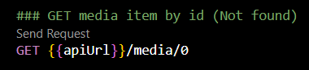

Response:

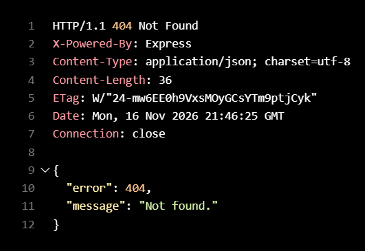

### 7. Add new media item with image (form-data)

HTTP request:

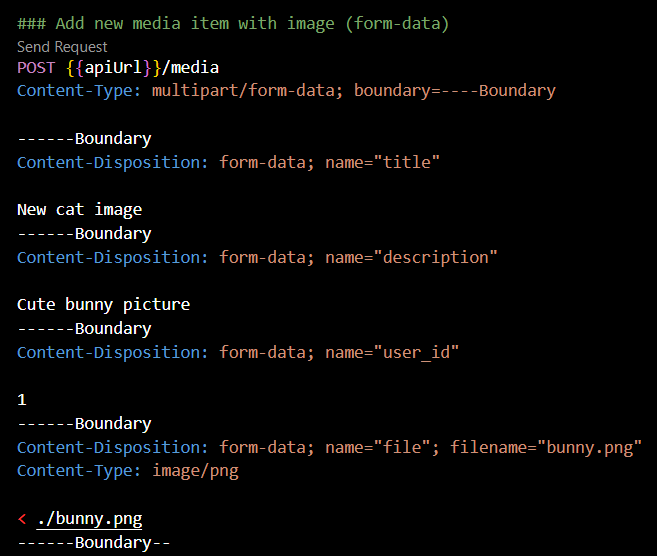

Response:

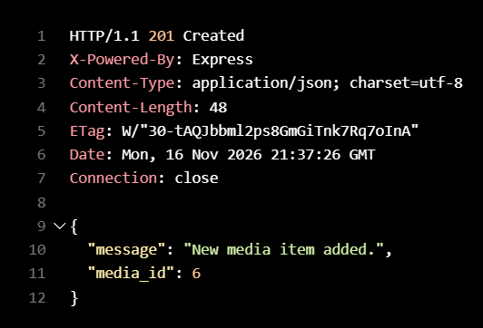

### 8. Modify existing media item

HTTP request:

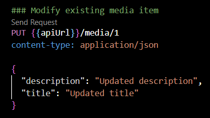

Response:

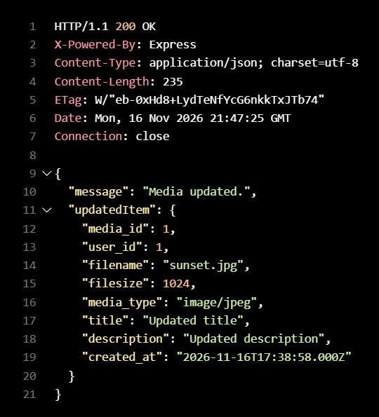

### 9. Delete media item

HTTP request:

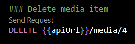

Response:

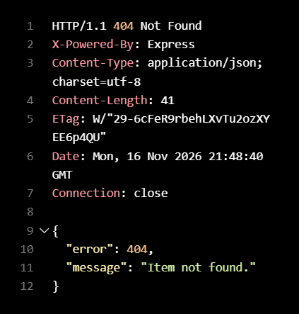
(poistamisen jälkeen## Kuvakaappaukset sovelluksen toiminnasta

### 1. Get server root

HTTP request:

Response:

### 2. Get api root

HTTP request:

Response:

---

## /media requests

### 3. GET all media items

HTTP request:

Response:

### 4. GET 2 media items

HTTP request:

Response:

### 5. GET media item by id

HTTP request:

Response:

### 6. GET media item by id (Not found)

HTTP request:

Response:

### 7. Add new media item with image (form-data)

HTTP request:

Response:

### 8. Modify existing media item

HTTP request:

Response:

### 9. Delete media item

HTTP request:

Response:

(poistamisen jälkeen / after deletion)

---

## /users requests

### 10. GET all users

HTTP request:

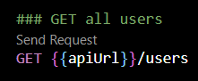

Response:

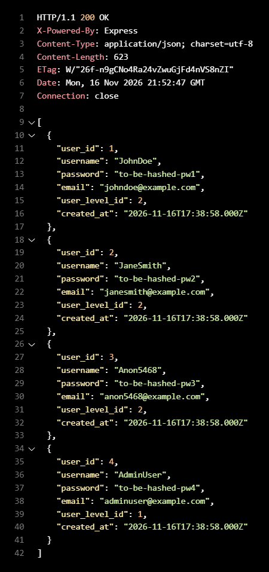

### 11. GET user by id

HTTP request:

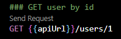

Response:

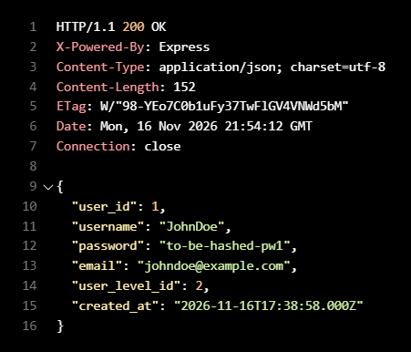

### 12. Add new user

HTTP request:

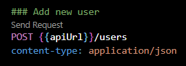

Response:

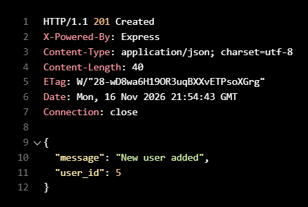

### 13. Modify existing user

HTTP request:

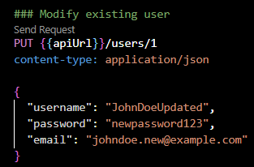

Response:

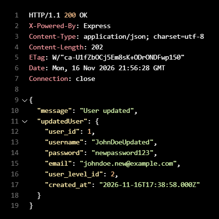

### 14. Delete user

HTTP request:

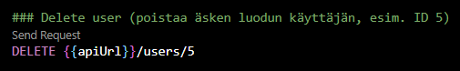

Response:

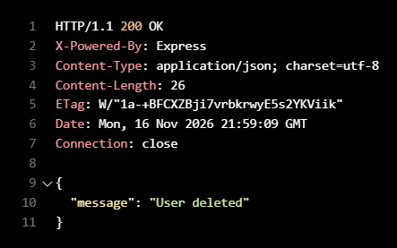

---

## /likes requests

### 15. GET likes for media item 1

HTTP request:

.png>)

Response:

.png>)

### 16. GET likes by user 2

HTTP request:

.png>)

Response:

.png>)

### 17. Add new like

HTTP request:

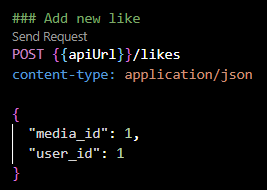

Response:

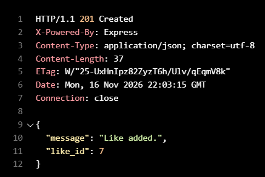

### 18. Delete like

HTTP request:

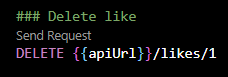

Response:

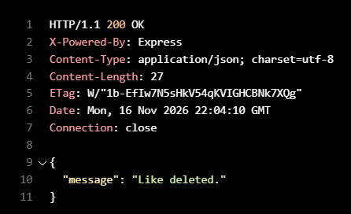)

---

## /users requests

### 10. GET all users

HTTP request:

Response:

### 11. GET user by id

HTTP request:

Response:

### 12. Add new user

HTTP request:

Response:

### 13. Modify existing user

HTTP request:

Response:

### 14. Delete user

HTTP request:

Response:

---

## /likes requests

### 15. GET likes for media item 1

HTTP request:

.png>)

Response:

.png>)

### 16. GET likes by user 2

HTTP request:

.png>)

Response:

.png>)

### 17. Add new like

HTTP request:

Response:

### 18. Delete like

HTTP request:

Response:

